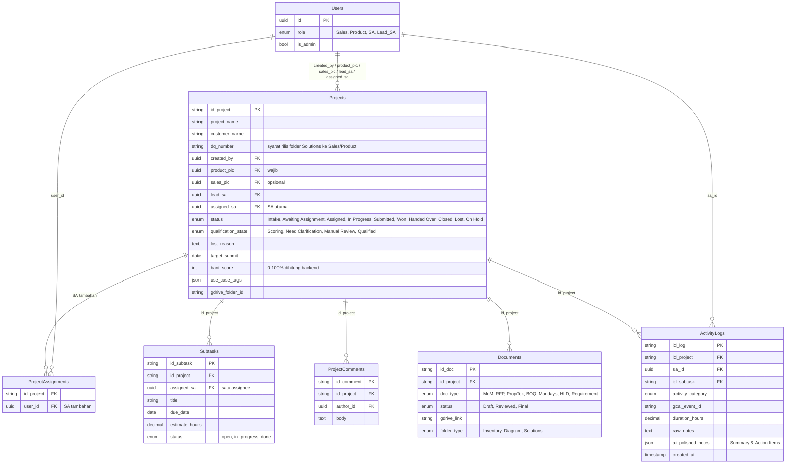

# Alur Bisnis Portal SA — Visualisasi Ground Truth

Dokumen ini adalah visualisasi **alur bisnis (business process flow)** Portal SA sebagaimana
didefinisikan di [`Spesifikasi_Teknis_Portal_SA.md`](Spesifikasi_Teknis_Portal_SA.md).

> **Sifat dokumen:** ini menggambarkan **perilaku produk yang dimaksudkan (intent)** sesuai spec —
> BUKAN status implementasi saat ini. Untuk jarak antara spec dan kode (apa yang sudah ✅ / 🟡 / 🔴),
> lihat [`docs/ROADMAP.md`](../docs/ROADMAP.md). Spec adalah sumber *niat*; kode adalah *realita*;
> roadmap adalah *jarak* di antara keduanya.

Diagram mengikuti empat alur kerja (workflow) di spec §2:

1. Pre-Sales Request & AI Scoring
2. Dokumen, SLA DQ Number & Gating System
3. Activity Mapping & Project Story
4. Post-Sales & PMO Handover

---

## Diagram Alur End-to-End

```mermaid
flowchart TD
    subgraph F1["Flow 1 — Pre-Sales Request & AI Scoring"]
        A1["Sales / Product / Lead SA mengisi form data customer,<br/>estimasi awal, Kuesioner, unggah MoM / RFP"]
        A2["Gemini AI (multimodal) ekstrak spesifikasi,<br/>validasi matriks BANT, tentukan Priority,<br/>Use Case Tagging, pre-fill OLA/Mandays"]
        A3{"BANT Score >= 60%?"}
        A4["qualification_state: Need Clarification<br/>pembuat / Product / Sales diminta revisi data"]
        A5["Notifikasi New Opportunity<br/>dikirim ke Lead SA untuk Assignment"]
        A1 --> A2 --> A3
        A3 -- "Tidak (< 60%)" --> A4
        A4 -. "revisi & submit ulang" .-> A2
        A3 -- "Ya (>= 60%)" --> A5
    end

    subgraph F2["Flow 2 — Dokumen, SLA DQ Number & Gating"]
        B1["Lead SA meng-assign SA ke proyek"]
        B2["Auto-provisioning folder GDrive:<br/>[Customer] > [Proyek] > Inventory / Diagram / Solutions<br/>(SA/Lead = Editor; Sales & Product = Viewer Inventory,<br/>No-Access ke Solutions sampai DQ terisi)"]
        B3["SA mengerjakan PropTek, BOQ (AWS Calc),<br/>Mandays di folder Solutions<br/>(tanpa menunggu DQ Number)"]
        B4{"DQ Number sudah diinput<br/>Sales / Product / Lead SA?"}
        B5{"SLA: < 5 hari?"}
        B6["Dokumen berstatus Reviewed →<br/>folder Solutions terbuka otomatis untuk<br/>Sales & Product + notifikasi email"]
        B7["Folder Solutions terkunci (Hidden/Locked)<br/>bagi Sales & Product"]
        B8["Reminder H+3 ke Sales & Product"]
        B9["Eskalasi H+5 ke lead_sa project & Admin"]
        B1 --> B2 --> B3 --> B4
        B4 -- "Ya" --> B6
        B4 -- "Belum" --> B5
        B5 -- "Ya (< 5 hari)" --> B7
        B5 -- "Lewat H+3" --> B8
        B5 -- "Lewat H+5" --> B9
        B8 -. "DQ diinput" .-> B6
        B9 -. "DQ diinput" .-> B6
    end

    subgraph F3["Flow 3 — Activity Mapping & Project Story"]
        C1["Sistem sync event dari Google Calendar SA<br/>(real-time)"]
        C2["SA memetakan event kalender ke<br/>Subtask Permanen + estimasi spent time"]
        C3["SA menulis catatan rapat (raw notes) kasual"]
        C4["Gemini AI merapikan jadi<br/>Poin Diskusi & Action Items terstruktur"]
        C5["Log masuk ke Project Story global<br/>(dapat dibaca semua pengguna,<br/>termasuk Backup SA untuk handover)"]
        C1 --> C2 --> C3 --> C4 --> C5
    end

    subgraph F4["Flow 4 — Post-Sales & PMO Handover"]
        D1["Proyek berstatus Won (PO Rilis)"]
        D2["Semua SA project menerima notifikasi<br/>WAJIB membuat HLD"]
        D3["AI (RAG) merekomendasikan template/referensi<br/>dari proyek Won serupa"]
        D4["SA submit HLD (status Final)"]
        D5["Handover dipicu manual: sistem membagikan folder<br/>Final_Deliverables + notifikasi/email handover<br/>ke PMO Lead & Delivery Lead (Viewer)<br/>status: Handed Over"]
        D6["PMO & Delivery menyusun<br/>Project Charter & LLD"]
        D7["SA tetap memantau; subtask baru boleh muncul.<br/>Lead SA / Admin menutup project (Closed)"]
        D1 --> D2 --> D3 --> D4 --> D5 --> D6
        D5 --> D7
    end

    A5 ==> B1
    B6 ==> C1
    B3 -. "aktivitas pengerjaan dicatat" .-> C2
    C5 ==> D1

    classDef decision fill:#fff3cd,stroke:#856404,color:#000;
    classDef ai fill:#e7f1ff,stroke:#0b5ed7,color:#000;
    class A3,B4,B5 decision;
    class A2,C4,D3 ai;
```

---

## Aktor & Peran

| Aktor | Peran dalam alur |
| :--- | :--- |
| **Sales** | Membuat project, mengisi Kuesioner dan DQ Number, memantau, menetapkan `Won`; opsional per project |
| **Product** | Setara Sales; selalu ada di setiap project |
| **Lead SA** | Menerima New Opportunity, meng-assign SA (utama/tambahan), membuat subtask, memantau beban; menerima eskalasi SLA DQ (H+5); boleh membuat project dan ditugaskan sebagai SA |
| **SA** | Mengerjakan dokumen teknis, subtask, mapping aktivitas, membuat HLD; satu project boleh punya beberapa SA |
| **Backup SA** | Collaborator (contributor) yang menulis log saat SA utama cuti; hak terbatas |
| **Admin** (`is_admin`) | Flag kemampuan pada satu role fungsional: kelola user, hak penuh, buka kembali Closed/Lost; menerima eskalasi SLA DQ (H+5) |
| **PMO Lead & Delivery Lead** | Menerima handover pasca Closed-Win untuk Project Charter & LLD |
| **Gemini AI** | BANT scoring, polishing activity notes, RAG recommendation |

## Integrasi yang Menggerakkan Alur (spec §4)

| Layanan | Titik dalam alur |
| :--- | :--- |
| **Google Drive** | Auto-provisioning folder + permission logic (Flow 2), handover folder (Flow 4) |
| **Google Calendar** | Pull event untuk activity mapping (Flow 3) |
| **Gmail** | Notifikasi trigger-based: assignment, update dokumen, eskalasi SLA, handover (semua flow) |
| **Google Gemini AI** | Multimodal parsing BANT (Flow 1), text structuring (Flow 3), RAG (Flow 4) |

---

## Entitas Data Inti (spec §3)

> Catatan: enum dan field di atas mengikuti **spec §3** (diperbarui 2026-11-13). Model kode aktual
> belum mengikutinya (role `Admin`, satu `sales_pic`/`assigned_sa`, enum `status` lama); jaraknya
> dilacak di [`docs/ROADMAP.md`](../docs/ROADMAP.md) Fase 8–9. Dokumen ini memegang versi spec sebagai ground truth.
